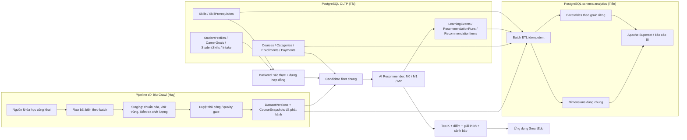
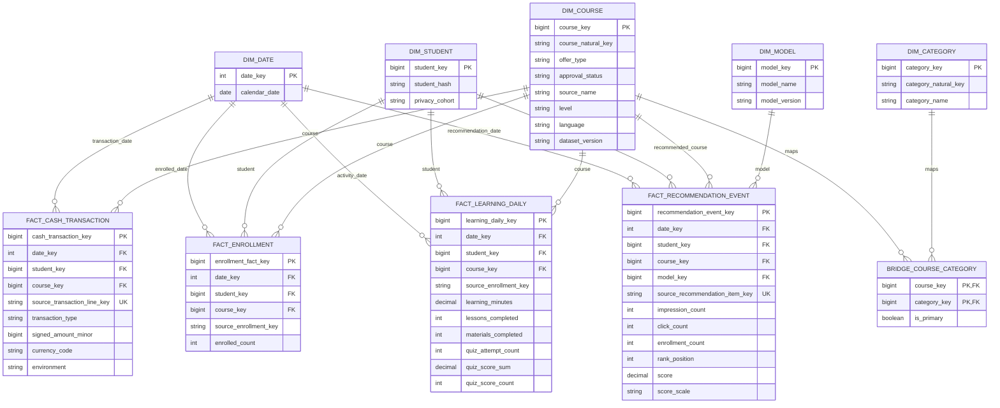

# Hợp đồng dữ liệu AI gợi ý & vùng Analytics

> Phạm vi: đặc tả đầu vào dùng chung cho `M0/M1/M2`, luồng OLTP/Crawl tới AI và
> Data Warehouse (DW), cùng grain và cấu trúc Star Schema đề xuất.
>
> Trạng thái: **Bản đề xuất để Tài, Huy và nhóm xác nhận**. Tài liệu này chưa
> chứng minh các thành viên đã thống nhất. Các bảng SmartEdu mới được ghi rõ là
> thiết kế mục tiêu; không giả định chúng đã tồn tại trong database hiện tại.

## 1. Cơ sở và phạm vi triển khai

Hợp đồng này dựa trên:

- Danh sách trường Crawl hiện tại: `id`, `title`, `url`, `price_vnd`,
  `original_price_vnd`, `categories`, `category_slugs`, `image_url`,
  `crawled_at`; `description`, `date_published`, `date_modified` chỉ có thể có
  khi chạy chế độ lấy chi tiết. Xem [README dữ liệu Crawl](../../data/README.md).
- Kế hoạch mở rộng dữ liệu nguồn gồm `provider`, `language`, `level`, `skills`,
  `prerequisites`, `duration_minutes`, `price_amount`, `price_currency`,
  `direct_skills`, `inferred_skills`, `offer_type`, trạng thái chất lượng và
  phát hành `dataset_version`. Các trường này là mục tiêu của pipeline Huy,
  chưa phải cam kết rằng chúng đã được triển khai.
- OLTP hiện có: `courses`, `categories`, `users`, `enrollments`, `payments`,
  `material_progress`, `lesson_progress`, `quiz_attempts`. Ví dụ:
  [Course](../../src/backend/app/models/course.py),
  [Enrollment](../../src/backend/app/models/enrollment.py),
  [Payment](../../src/backend/app/models/payment.py).
- Hồ sơ học tập, kỹ năng, tiên quyết, đơn hàng, hoàn tiền, `LearningEvents`,
  `DatasetVersions`, `RecommendationRuns`, `RecommendationItems` và
  `ModelEvaluations` là các bảng được nêu trong kế hoạch mở rộng tại
  [phân công nhóm](../../danhsachnhom.md), chưa được đăng ký trong
  [models/__init__.py](../../src/backend/app/models/__init__.py).

Tài liệu này thiết kế hợp đồng và kiến trúc, không tạo migration hay khẳng định
đã có dữ liệu lịch sử cho các bảng chưa triển khai.

### 1.1. Hợp đồng phát hành `DatasetVersions` (đề xuất)

`DatasetVersions` là metadata bất biến của một lần phát hành; dữ liệu khóa cụ
thể nằm trong `CourseSnapshots` và các bảng liên kết skill/category. Không sửa
snapshot của version đã phát hành: thay đổi dữ liệu phải tạo version mới. Tên
bảng/field dưới đây là hợp đồng đề xuất để Tài và Huy đối chiếu trước khi tạo
model/Alembic migration.

| Thực thể | Trường đề xuất | Bắt buộc sau phát hành | Quy tắc |
|---|---|---:|---|
| `DatasetVersions` | `id` UUID PK, `version` string UNIQUE, `status`, `is_active`, `created_at`, `published_at`, `created_by`, `approved_by`, `approved_at`, `record_count`, `manifest_sha256`, `schema_version`, `change_summary` | `id`, `version`, `status`, `is_active`, `published_at`, `approved_by`, `approved_at`, `record_count`, `manifest_sha256`, `schema_version` | `status` tối thiểu `draft`, `published`, `retired`; chỉ version `published` được đọc bởi AI. `is_active` không thay thế `version` cố định của một request. Phải có ràng buộc bảo đảm tối đa một version active nếu nghiệp vụ cần con trỏ `current`. |
| `CourseSnapshots` | `id` UUID PK, `dataset_version_id` FK, `source_name`, `source_course_id`, `canonical_url`, `title`, `description`, `provider`, `language`, `level`, `price_amount`, `price_currency`, `duration_minutes`, `required_hours_per_week`, `offer_type`, `quality_status`, `quality_flags`, `approval_status`, `captured_at`, `snapshot_hash` | khóa, version, nguồn/định danh nguồn, `title`, `offer_type`, trạng thái duyệt/chất lượng, `captured_at`, `snapshot_hash` | Unique đề xuất `(dataset_version_id, source_name, source_course_id)`; chỉ snapshot được duyệt và version đã phát hành cấp cho mô hình. `required_hours_per_week` phải là tải học/tuần có nguồn; không suy ra trực tiếp từ tổng `duration_minutes`. |
| `CourseSnapshotSkills` | `course_snapshot_id` FK, `skill_id` FK, `skill_origin`, `confidence`, `review_status` | khóa hai phía, `skill_origin` | `skill_origin` phân biệt `direct` và `inferred`; unique `(course_snapshot_id, skill_id, skill_origin)`. |
| `CourseSnapshotCategories` | `course_snapshot_id` FK, `category_id` FK, `source_category_label` | khóa hai phía | Bảng liên kết để không nhét danh sách nhiều giá trị vào một cột và tránh nhân dòng Fact khi join. |

`approved_by` tham chiếu actor quản trị theo cơ chế RBAC của OLTP; `created_by`
và người duyệt có thể là cùng người chỉ khi chính sách nhóm cho phép. Bản ghi
`EXTERNAL_REFERENCE` là dữ liệu tham khảo, không trở thành mặt hàng nội bộ được
bán. Những bản ghi thiếu trường tùy chọn vẫn có thể được duyệt nếu quality gate
cho phép; giá/thời lượng thiếu phải lưu `null`.

Enum đề xuất cần dùng thống nhất giữa API, snapshot và quản trị:

- `DatasetVersions.status`: `draft`, `published`, `retired`;
- `CourseSnapshots.quality_status`: `approved_candidate`, `needs_review`,
  `rejected` (đánh giá tự động chất lượng);
- `CourseSnapshots.approval_status`: `pending_review`, `approved`, `rejected`
  (quyết định duyệt của người có quyền);
- `offer_type`: `INTERNAL`, `EXTERNAL_REFERENCE`.

`approved_candidate` không đồng nghĩa `approved`: chỉ `quality_status =
approved_candidate AND approval_status = approved` trong version `published`
mới đủ điều kiện cấp cho recommender. Không cho phép trạng thái không nhận diện
lọt qua mặc định.

## 2. Nguyên tắc hợp đồng

1. Dùng `snake_case`, UUID cho khóa định danh nội bộ, thời gian ISO-8601 UTC,
   tiền dạng số nguyên theo đơn vị tiền tệ đã khai báo.
2. `null` nghĩa là **không biết/không được cung cấp**; không đổi `null` thành
   `0`, chuỗi rỗng, `BEGINNER`, hoặc giá trị mặc định suy đoán.
3. Với danh sách: `null` nghĩa là chưa biết/chưa nạp; `[]` nghĩa là đã biết và
   danh sách hiện rỗng. Không đồng nhất hai trạng thái này.
4. Chỉ dữ liệu khóa đã duyệt trong đúng `dataset_version` được cấp cho
   recommender. Không đưa dữ liệu `raw`/`staging` hoặc bản bị từ chối vào tập
   ứng viên.
5. Cả `M0`, `M1`, `M2` nhận cùng hồ sơ, phiên bản dữ liệu và tập ứng viên sau
   lọc cứng. Khác biệt giữa mô hình chỉ nằm ở cách xếp hạng.
6. Ghi lại `model_version`, `dataset_version`, dấu thời gian và các thành phần
   điểm để tái lập kết quả; không đưa thông tin nhận dạng trực tiếp vào DW.

## 3. Hợp đồng đầu vào Recommender

### 3.1. Hồ sơ học viên và ràng buộc truy vấn

Đây là hợp đồng chuẩn hóa đề xuất giữa API Backend và AI. Backend chịu trách
nhiệm xác thực quyền sở hữu `student_id`; hồ sơ offline dùng `learner_key` giả
danh thay cho UUID người dùng.

| Trường | Kiểu / bắt buộc | Có thể `null`? | Nguồn và quy tắc |
|---|---|---:|---|
| `request_id` | UUID, bắt buộc | Không | ID duy nhất cho lượt yêu cầu; dùng đối chiếu log. |
| `student_id` | UUID, bắt buộc với request online | Không | `users.id`; chỉ truyền nội bộ qua Backend-AI. Không xuất thẳng sang DW. |
| `learner_key` | string, chỉ dùng offline | Có | Mã giả danh cho dữ liệu đánh giá; không đồng thời cần `student_id`. |
| `dataset_version_id` | UUID hoặc version key, bắt buộc | Không | Phiên bản đã phát hành; phải cố định cho toàn bộ lượt xếp hạng. |
| `profile.goals` | mảng `{goal_id, label?}` | Có | Mục tiêu nghề nghiệp từ hồ sơ/taxonomy; `null` khi chưa khai báo. |
| `profile.current_skills` | mảng skill object | Có | Kỹ năng đã có từ hồ sơ hoặc intake; mỗi phần tử theo cấu trúc bên dưới. |
| `profile.target_level` | enum `BEGINNER`, `INTERMEDIATE`, `ADVANCED` | Có | Cấp độ do người học khai báo hoặc quy đổi theo intake; lưu nguồn riêng. |
| `profile.level_source` | enum `self_report`, `intake_test`, `null` | Có | Không suy ra nguồn khi thiếu dữ liệu. |
| `constraints.max_budget_amount` | decimal/integer | Có | Ngân sách tối đa; `null` thì bỏ lọc ngân sách, không phải miễn phí. |
| `constraints.currency` | ISO 4217 | Có | Bắt buộc nếu ngân sách có giá trị; chưa xác định thì `null`. |
| `constraints.available_hours_per_week` | số dương | Có | `null` thì không áp dụng lọc theo quỹ thời gian. |
| `constraints.exclude_enrolled_or_completed` | boolean | Không | Giá trị do Backend cung cấp theo chính sách; trạng thái ghi danh lấy từ OLTP. |
| `constraints.exclude_course_ids` | mảng UUID | Có | Khóa đã mua/đã học hoặc bị loại bởi người dùng; `null` là chưa biết, `[]` là không có. |
| `top_k` | số nguyên dương | Không | Số kết quả tối đa. |
| `model` | `M0`, `M1`, hoặc `M2` | Không | Cho phép chọn mô hình để đánh giá/demo. |

`current_skills` dùng cấu trúc:

| Trường | Kiểu / bắt buộc | Có thể `null`? | Quy tắc |
|---|---|---:|---|
| `skill_id` | string | Không | ID ổn định trong taxonomy chung. |
| `proficiency` | enum hoặc số đã chuẩn hóa `[0,1]` | Có | `null` nếu chưa đo; không tự gán mức trung bình. |
| `source` | `self_report`, `intake_test`, `verified`, `null` | Có | Phân biệt kỹ năng tự khai báo với kết quả kiểm tra/xác minh. |
| `confidence` | số `[0,1]` | Có | Độ tin cậy của ánh xạ/đánh giá; `null` nếu chưa có. |

### Ánh xạ trường từ nguồn nghiệp vụ và dataset

| Feature/hành vi | Nguồn ưu tiên | Quy tắc dựng input |
|---|---|---|
| Mục tiêu nghề nghiệp | Mục tiêu đã xác nhận từ `StudentProfiles`/`CareerGoals` (bảng kế hoạch) | Chỉ gửi mục tiêu đang hiệu lực; chưa khai báo thì `goals: null`, không đoán từ ngành học. |
| Kỹ năng hiện có | `StudentSkills` (kế hoạch), gắn taxonomy `Skills`; nguồn có thể là tự khai báo hoặc intake test | Giữ `skill_id`, mức độ, `source`, `confidence`; không trộn kỹ năng mục tiêu của khóa vào kỹ năng đã đạt. |
| Cấp độ | Hồ sơ/intake test đã xác nhận | Gửi cùng `level_source`; không có dữ liệu thì `null`. |
| Ngân sách và giờ học | `StudentProfiles` (kế hoạch) | Chỉ lọc theo giá/thời lượng khi cả giá trị hồ sơ và dữ liệu khóa cần thiết đều có; trường thiếu sinh warning. |
| Đã mua/đã học | `enrollments` hiện có (`student_id`, `course_id`, `status`, `completed_at`) và lịch sử đơn/thanh toán nếu được triển khai | Backend dựng danh sách loại trừ theo định nghĩa trạng thái đã chốt; không dựa vào `view_count` để kết luận đã học. |
| Metadata khóa nội bộ | `courses` hiện có (`id`, `title`, `description`, `price_vnd`, `status`, `level`, `language`, `category_id`, `tags`) | Chỉ dùng trạng thái publish/approval hợp lệ sau khi Tài thống nhất mapping giữa `status` hiện tại và `approval_status` mới. |
| Metadata khóa Crawl | `CourseSnapshots` thuộc `DatasetVersions` đã phát hành (kế hoạch) | Chọn đúng version trong request; giữ `null` theo snapshot; khóa ngoài luôn `EXTERNAL_REFERENCE`. |
| Danh mục | `categories` hiện có cho OLTP; taxonomy/danh mục nguồn trong snapshot | Ánh xạ qua ID chuẩn; không nối danh sách category trực tiếp vào Fact. |
| Kỹ năng mục tiêu/tiên quyết khóa | `CourseSkills`, `CoursePrerequisites`, `Skills`, `SkillPrerequisites` (kế hoạch) | Phân biệt skill đầu ra và prerequisite; chỉ dùng taxonomy/version đã duyệt. |
| Thuộc tính thanh toán/ghi danh | `payments` hiện có (`amount_vnd`, `payment_status`, `paid_at`) và `enrollments` | Chỉ giao dịch xác nhận mới tính doanh thu; hợp đồng đơn/hoàn tiền tương lai phải giữ liên kết đến order item/payment. |
| Tiến độ học | `material_progress`, `lesson_progress`, `quiz_attempts` hiện có; `LearningEvents` là kế hoạch | Nguồn hiện tại phù hợp snapshot tiến độ; phân tích hoạt động theo ngày cần sự kiện có timestamp hoặc quy tắc attribution được chốt. |

### 3.2. Bản ghi khóa học được cấp cho mô hình

Một bản ghi ứng viên gồm trường nguồn đã được chuẩn hóa và kiểm duyệt. Trường
không có trong nguồn phải giữ `null`; không tự điền giá, thời lượng, cấp độ hay
kỹ năng.

| Trường | Kiểu / bắt buộc | Có thể `null`? | Ghi chú |
|---|---|---:|---|
| `course_id` | UUID nội bộ hoặc khóa ổn định, bắt buộc | Không | ID dùng để nối snapshot, khóa nội bộ hoặc bản ghi external đã nhập. |
| `dataset_version_id` | UUID/version key, bắt buộc với dữ liệu Crawl | Không | Phải khớp phiên bản trong request. |
| `source_name` | string | Có | Nguồn Crawl; bổ sung cho bộ lọc nguồn/D1. |
| `source_course_id` | string | Có | ID khóa ở nguồn ngoài; không thay thế `course_id`. |
| `canonical_url` | URL | Có | URL gốc đã chuẩn hóa; bắt buộc với khóa tham khảo ngoài. |
| `title` | string | Không | Có ở `courses.title` và bản ghi Crawl. |
| `description` | string | Có | Có thể thiếu; mô hình văn bản không được giả định mô tả tồn tại. |
| `provider` | string | Có | Trường mục tiêu của pipeline Crawl. |
| `category_ids` | mảng ID | Có | Kết hợp taxonomy nội bộ và mapping danh mục nguồn nếu có. |
| `language` | mã ngôn ngữ | Có | Chuẩn hóa BCP 47/ISO đã thống nhất; không suy đoán từ tên khóa. |
| `level` | enum chuẩn | Có | Giá trị nguồn phải ánh xạ taxonomy; giữ `null` nếu không ánh xạ được. |
| `price_amount` | số không âm | Có | `null` không có nghĩa là miễn phí. |
| `price_currency` | ISO 4217 | Có | Bắt buộc khi `price_amount` có giá trị. |
| `duration_minutes` | số nguyên dương | Có | Giá trị thiếu giữ `null`; chỉ dùng lọc thời gian khi có quy tắc quy đổi được nhóm chấp thuận. |
| `required_hours_per_week` | số không âm | Có | Tải học ước tính/tuần đã được nguồn cung cấp hoặc nhóm xác nhận; không thể suy ra chỉ từ `duration_minutes`. Nếu người học có giới hạn giờ/tuần mà trường này thiếu, ứng viên bị loại vì chưa xác minh được ràng buộc. |
| `direct_skills` | mảng skill object | Có | Kỹ năng nêu trực tiếp trên nguồn; mỗi mục gồm `skill_id`, `source`, `confidence`. |
| `inferred_skills` | mảng skill object | Có | Kỹ năng suy luận; giữ nguồn/confidence và cờ rà soát, không gộp âm thầm vào kỹ năng trực tiếp. |
| `prerequisite_skill_ids` | mảng skill ID | Có | Tiên quyết khóa học đã ánh xạ taxonomy; `null` là chưa rõ, không đồng nghĩa không có tiên quyết. |
| `offer_type` | `INTERNAL` / `EXTERNAL_REFERENCE` | Không | Phân biệt khóa nội bộ và khóa tham khảo ngoài. |
| `approval_status` | enum trạng thái | Không | Chỉ `approved` được đưa vào tập ứng viên. |
| `quality_flags` | mảng string | Có | Cờ thiếu trường/chất lượng; `[]` khi đã kiểm tra và không có cờ. |

### 3.3. Ý nghĩa đầu vào theo mô hình

| Mô hình | Sử dụng | Không được làm |
|---|---|---|
| `M0` — TF-IDF | `goals`, kỹ năng hồ sơ và văn bản khóa `title`, `description`, `direct_skills`, `inferred_skills` sau chuẩn hóa; cosine similarity và baseline phổ biến khi cần. | Không coi mô tả thiếu là chuỗi có nội dung; không dùng khóa chưa duyệt. |
| `M1` — Embedding | Cùng nội dung đầu vào văn bản với `M0`, mã hóa đa ngữ; cache embedding theo `course_id` + `dataset_version_id` + model embedding version. | Không dùng embedding của version cũ cho khóa đã đổi nội dung. |
| `M2` — Hybrid | `S` khớp ngữ nghĩa, `G` độ bao phủ kỹ năng còn thiếu, `L` mức phù hợp cấp độ; điểm `100 × (0.50×S + 0.35×G + 0.15×L)` với thành phần trong `[0,1]`. | Giá/hoa hồng không tác động tăng điểm; thiếu dữ liệu không được biến thành điểm mặc định giả. |

Lọc trạng thái duyệt, loại khóa, khóa đã học/đã mua, ngân sách, thời gian và
tiên quyết được chạy **trước** xếp hạng và dùng chung cho cả ba mô hình. Khi
thiếu ngân sách hoặc thời lượng, bỏ riêng bộ lọc đó và trả `missing_fields_warning`;
không loại hết ứng viên chỉ vì trường tùy chọn bị thiếu. Tiên quyết được kiểm tra
theo đồ thị kỹ năng đã duyệt; trường tiên quyết chưa biết phải được gắn cảnh báo
và xử lý theo quy tắc do nhóm chốt, không được ngầm xem là đã thỏa mãn.

Với bộ lọc `available_hours_per_week`, chỉ so sánh với
`required_hours_per_week` của khóa. Không coi tổng thời lượng khóa là tải học
mỗi tuần. Nếu hồ sơ không khai báo giờ/tuần thì giữ ứng viên và phát cảnh báo;
nếu hồ sơ có giới hạn nhưng khóa không có tải/tuần thì loại ứng viên với lý do
thiếu dữ liệu kiểm chứng. `CoursePrerequisites` được nạp thành ánh xạ từ
`course_id` sang danh sách khóa tiên quyết: danh sách rỗng là đã biết không có
tiên quyết; thiếu mapping hoặc lịch sử hoàn thành của học viên khi khóa có
tiên quyết thì fail-closed để không có vi phạm tiên quyết.

Hồ sơ cold-start là hồ sơ không có mục tiêu, kỹ năng hiện tại và cấp độ mục
tiêu. Khi cold-start hoặc ranker không trả kết quả, dùng `fallback_candidates`
đã qua toàn bộ hard filters, sắp theo `popularity_score` giảm dần và tie-break
bằng `course_id`. Nếu không có ứng viên hợp lệ, trả danh sách rỗng kèm
`no_eligible_candidates`; tuyệt đối không nới trạng thái duyệt, loại khóa, sở
hữu/ghi danh, ngân sách hay tiên quyết để tạo kết quả giả.

Hiện thực hóa tại [candidate_filter.py](../../src/ai/src/recommendations/candidate_filter.py):
orchestrator gọi `filter_candidates` **một lần trước khi chọn M0/M1/M2**, rồi
truyền cùng `result.candidates` (cùng IDs, cùng thứ tự chuẩn hóa) cho từng
ranker. `result.fallback_candidates` là pool đã qua các hard filters và chỉ
dùng khi hồ sơ cold-start hoặc ranker không trả kết quả; `candidate_warnings`
và `rejected_candidates` giữ lý do để API/telemetry giải thích được quyết định.
Không gọi lại bộ lọc với tham số khác nhau cho từng mô hình.

### 3.4. Bản ghi tái lập lượt gợi ý

Mỗi lượt chạy cần lưu tối thiểu:

```json
{
  "request_id": "uuid",
  "model": "M2",
  "model_version": "string",
  "dataset_version_id": "uuid-or-version-key",
  "created_at": "ISO-8601 UTC",
  "candidate_set_hash": "string",
  "items": [
    {
      "course_id": "uuid",
      "rank": 1,
      "score": 0.0,
      "score_scale": "0-100",
      "score_components": {"S": 0.0, "G": 0.0, "L": 0.0},
      "explanation_evidence": [],
      "warnings": []
    }
  ]
}
```

`candidate_set_hash` là checksum của ID ứng viên sau lọc theo thứ tự chuẩn hóa;
không chứa PII. `score_scale` phải khai báo thang điểm của `score`; với `M2`,
công thức hiện được phân công cho ra thang `[0,100]`. Thang điểm đầu ra của
`M0/M1` cần được chốt trong hợp đồng API trước khi so sánh điểm số; không được
nhầm điểm phù hợp là xác suất thành công. Lời giải thích chỉ được dẫn từ dữ liệu
hồ sơ/khóa hoặc cờ thiếu trường đã ghi nhận.

Ví dụ payload chuẩn dưới đây minh họa `null` khác với danh sách rỗng; ID chỉ là
giá trị minh họa, không phải seed dữ liệu:

```json
{
  "request_id": "00000000-0000-4000-8000-000000000001",
  "student_id": "00000000-0000-4000-8000-000000000002",
  "dataset_version_id": "dataset-2026-11-01",
  "model": "M2",
  "top_k": 5,
  "profile": {
    "goals": null,
    "current_skills": [],
    "target_level": null,
    "level_source": null
  },
  "constraints": {
    "max_budget_amount": null,
    "currency": "VND",
    "available_hours_per_week": null,
    "exclude_enrolled_or_completed": true,
    "exclude_course_ids": []
  }
}
```

Trong ví dụ: hồ sơ đã biết hiện chưa có skill nào (`[]`), mục tiêu/cấp độ chưa
được khai báo (`null`), ngân sách/giờ học chưa biết nên không áp dụng hai bộ lọc
này. Nếu chưa biết trạng thái danh sách loại trừ thì phải gửi `null`, không gửi
`[]`.

### 3.5. Baseline M0 TF-IDF và đánh giá offline

Hiện thực M0 trong [tfidf_baseline.py](../../src/ai/src/recommendations/tfidf_baseline.py)
xếp hạng `goals`, `current_skills` và `target_text` của hồ sơ so với `title`,
`description`, `skills`, `direct_skills` và `inferred_skills` của snapshot khóa.
`null` và nội dung rỗng không được thay bằng văn bản giả. Vectorizer giữ Unicode,
hạ chữ thường, dùng unigram/bigram và TF-IDF L2; cosine similarity là điểm
`[0,1]`, không phải xác suất. Hồ sơ không có token hoặc không khớp token nào
được xếp theo popularity giảm dần, sau đó `course_id` tăng dần; điểm cosine
fallback vẫn là `0`.

Chạy đánh giá trên **toàn bộ** hồ sơ kiểm thử offline:

```powershell
cd nhom07-65httt/src/ai
python -m src.recommendations.evaluate_tfidf `
  --courses path/to/approved-courses.json `
  --profiles path/to/test-profiles.json `
  --dataset-version dataset-2026-11-01 `
  --top-k 5 `
  --output artifacts/m0-top-k.csv
```

Hai file đầu vào là JSON array. Course cần `course_id` và `title`, có thể có
`description`, `skills`, `direct_skills`, `inferred_skills` và `popularity_score`.
Profile cần `learner_key`; goals/current skills có thể là chuỗi, danh sách chuỗi
hoặc object có `label`/ID. `candidate_course_ids` tùy chọn cho phép truyền tập
đã qua cùng hard filters; nếu thiếu, dùng toàn bộ catalog đã duyệt được đưa vào.
Profile không có ứng viên vẫn có một dòng trạng thái riêng trong CSV, không bị
bỏ khỏi đánh giá.

CSV chứa Top-K và điểm cho mỗi hồ sơ; file `.metadata.json` ghi cấu hình
vectorizer, phiên bản scikit-learn/Python, phiên bản dữ liệu, hash đầu vào/đầu
ra, hash tập ứng viên theo hồ sơ và thống kê fallback. M0 không có ngẫu nhiên;
cùng đầu vào, phiên bản dependency và cấu hình cho kết quả/xếp hạng lặp lại.
Để so sánh M1/M2, cấp cho mỗi ranker cùng `dataset_version_id` và
`candidate_course_ids`; hash ứng viên được xuất để kiểm tra điều đó. Dataset
Crawl hiện tại chỉ có tiêu đề/danh mục và không phải bộ hồ sơ benchmark; cần
chuẩn bị catalog đã duyệt có metadata và tập profile kiểm thử thực trước khi
chạy đánh giá dự án.

## 4. Luồng dữ liệu OLTP, Crawl, AI và DW



DW đọc từ OLTP và phiên bản Crawl đã phát hành qua ETL; AI đọc hồ sơ/taxonomy
được Backend cho phép và dữ liệu khóa đã duyệt. Không dùng schema `analytics`
làm nguồn ghi nghiệp vụ, và không để AI đọc bảng staging/raw.

## 5. Star Schema đề xuất cho `analytics`

Tên logic trong sơ đồ theo yêu cầu nhóm (`DimDate`, `FactEnrollment`, v.v.).
Tên vật lý PostgreSQL nên viết thường `snake_case` và không quote: ví dụ
`analytics.dim_date`, `analytics.dim_student`,
`analytics.fact_recommendation_event`, `analytics.etl_batch_logs`. `analytics`
là schema riêng, không dùng chung namespace với các bảng OLTP.

### 5.1. Sơ đồ quan hệ và grain



| Bảng Fact | Grain — đúng một dòng đại diện cho | Measures/thuộc tính tối thiểu | Nguồn chính |
|---|---|---|---|
| `FactCashTransaction` | Một khoản thu hoặc hoàn tiền gắn với một dòng đơn hàng/giao dịch | `signed_amount_minor` (thu dương, hoàn âm), `currency_code`, `transaction_type`, `environment` (`REAL`/`SANDBOX`/`DEMO`) | Mục tiêu: `Orders`, `OrderItems`, thanh toán, `Refunds`; hiện tại có `payments` gắn `course_id`/`student_id`/`amount_vnd`, chưa có Refunds/OrderItems. |
| `FactEnrollment` | Một ghi danh vào một khóa học | `enrolled_count = 1`, trạng thái ghi danh | `enrollments`; khóa tự do cần xử lý theo quy tắc thống nhất, không ghi nhận doanh thu giả. Số tiền chỉ tính từ `FactCashTransaction`, không cộng tiền ở Fact này. |
| `FactLearningDaily` | Một học viên × một ghi danh/khóa × một ngày hoạt động | Phút học hợp lệ, số bài học/tài liệu hoàn thành trong ngày, số lượt quiz, điểm quiz theo quy ước thống nhất | Mục tiêu: `LearningEvents`; hiện tại có tiến độ tài liệu/bài học và `quiz_attempts`, chưa có nhật ký sự kiện học chuẩn hóa. |
| `FactRecommendationEvent` | Một recommendation item hiển thị trong một request/run; `source_recommendation_item_key` là duy nhất | `impression_count = 1`, `click_count` (0/1 item được click), `enrollment_count` (0/1 nếu attribution xác nhận), vị trí xếp hạng, điểm/thành phần điểm, mô hình | `RecommendationRuns`, `RecommendationItems` và event tracking; các bảng này hiện chưa có. |

### 5.2. Dimension, khóa và lịch sử

- `DimDate`: `date_key` PK dạng `YYYYMMDD`, `calendar_date`, ngày/tuần/tháng/
  quý/năm và cờ cuối tuần. Dùng role-playing date key nếu Fact có nhiều loại
  ngày; UTC là chuẩn lưu trữ, múi giờ báo cáo áp dụng ở lớp BI.
- `DimStudent`: `student_key` surrogate PK, `student_hash` unique, cohort/nhóm
  phân tích tối thiểu cần thiết. Hash là HMAC có secret ngoài DW; không lưu
  email, tên, token hoặc hash email thường.
- `DimCourse`: `course_key` surrogate PK, `course_natural_key`, `offer_type`,
  trạng thái duyệt, nguồn, nhà cung cấp, cấp độ, ngôn ngữ, version dữ liệu và
  thuộc tính cần lọc. SCD Type 2 dùng `effective_from`, `effective_to`,
  `is_current`; facts trỏ đúng bản ghi dimension có hiệu lực tại sự kiện.
- `DimCategory`: `category_key` surrogate PK, `category_natural_key`,
  `category_name`, `parent_category_key` nếu taxonomy phân cấp.
- `BridgeCourseCategory`: một dòng trên mỗi cặp khóa/danh mục, có
  `is_primary`; dùng để lọc/report danh mục. Không join bridge trực tiếp vào
  tổng tiền/tổng học tập nếu chưa loại trùng hoặc phân bổ trọng số.
- `DimModel`: `model_key` surrogate PK, `model_name`, `model_version`,
  `embedding_model_version` và cấu hình/score scale cần cho tái lập.
- `dataset_version` và `source_name` phải có sẵn trong `DimCourse` (hoặc dimension
  riêng khi volume/BI yêu cầu); dashboard có thể lọc D1 theo dataset/source mà
  không cần nối dữ liệu raw. `etl_batch_logs` là bảng kiểm soát tải, không phải
  dimension/fact hành vi.

### 5.3. Khóa và grain duy nhất để UPSERT

| Fact | Khóa nguồn duy nhất tối thiểu | Foreign keys tối thiểu | Quy tắc measure |
|---|---|---|---|
| `FactCashTransaction` | `source_transaction_line_key` (order item + payment/refund line; với schema cũ có thể là payment ID cho giao dịch thu) | `date_key`, `student_key`, `course_key` | `signed_amount_minor`, `currency_code`, `transaction_type`, `environment`; chỉ giao dịch đã xác nhận. Hoàn tiền là amount âm. |
| `FactEnrollment` | `source_enrollment_key` (`enrollments.id`) | `date_key`, `student_key`, `course_key` | `enrolled_count = 1`; không có measure doanh thu. |
| `FactLearningDaily` | `(source_enrollment_key, date_key)` | `date_key`, `student_key`, `course_key` | Tổng theo enrollment/ngày; `learning_minutes`, `lessons_completed`, `materials_completed`, `quiz_attempt_count`, `quiz_score_sum`, `quiz_score_count`. |
| `FactRecommendationEvent` | `source_recommendation_item_key` (ổn định và duy nhất trong một run) | `date_key`, `student_key`, `course_key`, `model_key` | Một dòng cho một recommendation item thực sự được hiển thị; impression bằng 1; click/enrollment attribution chỉ cập nhật khi event được ghi nhận. Gửi event lặp phải idempotent theo recommendation item. |

Mọi Fact có surrogate PK để join nội bộ và unique constraint trên khóa nguồn/grain
ở trên. Event impression/click phải mang recommendation item ID ổn định và
idempotency key; không khử trùng bằng timestamp gần đúng. Các điểm quiz được lưu
numerator/denominator để tính trung bình có trọng số; không lấy trung bình của
các trung bình theo ngày.

### 5.4. Quy tắc không nhân đôi và tính chỉ số

1. Không join trực tiếp `FactCashTransaction` với `FactLearningDaily` hoặc
   `FactRecommendationEvent` ở grain chi tiết. Tổng tiền và thời gian học phải
   được tổng hợp riêng theo dimension/period rồi mới ghép ở grain chung.
2. `FactCashTransaction` ghi một khoản hoàn là dòng âm liên kết khoản thu/dòng
   đơn gốc. Tổng thu ròng = tổng khoản thu hợp lệ + tổng hoàn âm; tách `REAL`,
   `SANDBOX`, `DEMO` bằng dimension/thuộc tính môi trường. `FactEnrollment`
   không chứa measure tiền cộng dồn để tránh tính doanh thu hai lần.
3. Mỗi Fact có khóa nguồn ổn định và unique constraint tương ứng grain để ETL
   `UPSERT` idempotent. Batch thất bại phải rollback/đánh dấu lỗi; không được
   ghi nhận hoàn tất giả.
4. CTR = clicks / impressions; conversion = enrollments attributed / impressions
   hoặc clicks theo định nghĩa dashboard đã chọn. Mẫu số bằng 0 phải hiển thị
   “chưa đủ dữ liệu”, không chia 0.
5. `NDCG@5`, `Precision@5`, P95 và các đánh giá offline thuộc bảng đánh giá/
   báo cáo theo `model_version`, `dataset_version`, tập test và thời điểm chạy;
   không trộn với chỉ số Fact giao dịch hoặc coi metric đánh giá là event người dùng.

## 6. Quy tắc ETL, bảo mật và kiểm tra nghiệm thu

- Tách schema PostgreSQL `analytics` khỏi OLTP; cấp Superset role chỉ có quyền
  `SELECT` trên schema này. ETL là writer có quyền tối thiểu cần thiết.
- Batch ghi `batch_id`, thời gian bắt đầu/kết thúc, version nguồn, trạng thái,
  số dòng đọc/insert/update/reject và lỗi kiểm tra. Không lưu bản ghi thô có PII
  trong log. `etl_batch_logs` tối thiểu có `batch_id` PK, `source_name`,
  `dataset_version`, `started_at`, `finished_at`, `status`, các bộ đếm dòng,
  `error_summary` đã loại dữ liệu nhạy cảm.
- Mỗi batch xác nhận khóa ngoại, uniqueness theo grain, miền giá trị, version
  dataset đã phát hành và đối chiếu tổng tiền nguồn–đích. Sai lệch phải báo lỗi,
  không được âm thầm loại bỏ.
- Kiểm tra contract AI: `null` được bảo toàn; tiền/thời lượng thiếu không thành
  `0`; bản ghi chưa duyệt không lọt vào candidate set; ba mô hình dùng cùng
  candidate IDs; mọi output tham chiếu được `dataset_version` và `model_version`.
- Kiểm tra DW: chạy lặp batch không đổi số đếm/tổng tiền; hoàn tiền làm giảm
  doanh thu ròng đúng một lần; số liệu học tập không nhân tiền; student key không
  tiết lộ PII.

### Tiêu chí nghiệm thu có thể kiểm chứng

1. Contract input có field, kiểu, nullability và nguồn cho hồ sơ, ràng buộc, khóa
   được duyệt, khóa dữ liệu version và metadata mô hình; payload mẫu biểu diễn
   đúng khác biệt `null`/`[]`.
2. Với cùng `request_id`, `dataset_version_id` và cùng kết quả candidate filter,
   `M0/M1/M2` nhận cùng tập `course_id`; output truy lại được model/data version.
3. Candidate không chứa snapshot chưa duyệt, version chưa published hoặc khóa
   ngoài có hành động mua nội bộ; ngân sách/thời lượng null không làm giá trị
   thành zero.
4. Mỗi Fact có grain, source key, foreign keys và quy tắc upsert rõ; count/tổng
   tiền không đổi khi chạy lặp batch; hoàn tiền được tính đúng một lần.
5. Student DW key không thể tra ngược danh tính từ chính dữ liệu analytics;
   Superset role chỉ đọc được schema analytics.
6. Các con số dashboard theo nguồn/version/model/danh mục được lọc mà không
   nhân dòng Fact; mẫu số 0 được xử lý thành “chưa đủ dữ liệu”.

## 7. Các quyết định cần chốt với Tài, Huy và nhóm

Trước khi coi hợp đồng này là thống nhất hoặc tạo migration/API cần ghi nhận
quyết định cho các mục sau:

1. Khóa chính và cấu trúc chính thức của `DatasetVersions`/`CourseSnapshots`;
   quy tắc phát hành, thu hồi version và liên kết khóa Crawl với `courses.id`.
2. Danh mục `level`, `language`, currency và taxonomy IDs; quy ước các khóa có
   nhiều category/skill; cách giữ `direct_skills` tách với `inferred_skills`.
3. Đơn vị, thời điểm áp dụng và hành vi khi thiếu ngân sách/thời lượng; xử lý
   tiên quyết chưa biết; định nghĩa khóa “đã học” và “đã mua”.
4. API AI online dùng `student_id` hay payload hồ sơ đã dựng sẵn; trường nào
   được phép log, thời hạn lưu và cách giả danh cho đánh giá offline.
5. Định nghĩa chuẩn của môi trường `REAL`/`SANDBOX`/`DEMO`, hoàn tiền, ghi danh
   miễn phí, event click/impression và attribution conversion.
6. Xác nhận grain cuối của `FactLearningDaily` (đặc biệt đơn vị thời gian học)
   và `FactRecommendationEvent` (một dòng theo lần hiển thị hay loại event).
7. Chốt quyền truy cập, thuật toán giả danh `DimStudent`, thời hạn lưu dữ liệu
   analytics và xử lý yêu cầu xóa dữ liệu cá nhân.

**Biên bản xác nhận cần ghi trước khi chuyển trạng thái:** Tài xác nhận bảng
nguồn/khóa phát hành và ranh giới OLTP; Huy xác nhận trường Crawl, nullability,
quality gate và version; Tiến chốt input chung M0/M1/M2, grain Fact và kiểm tra
ETL; cả nhóm ghi nhận các quyết định trên. Tài liệu chỉ được đổi trạng thái
thành “đã thống nhất” sau khi các xác nhận này được ghi nhận.
